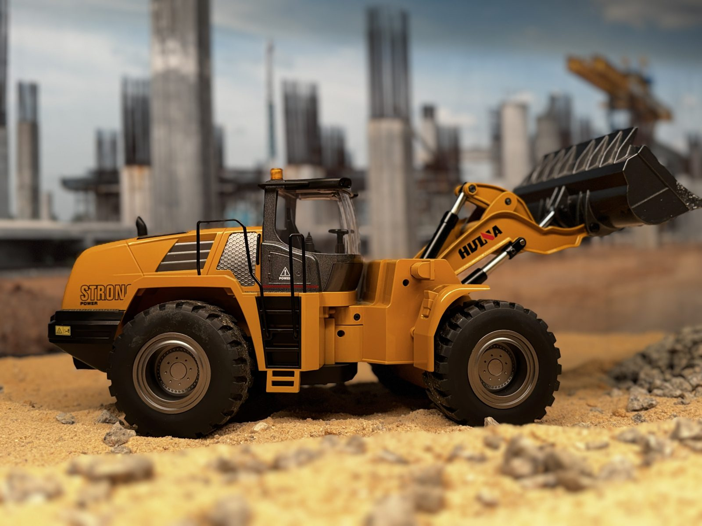
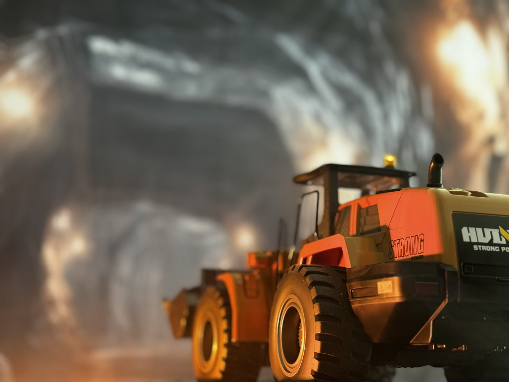

---
tags:
  - Character
  - Military
  - Project H
---

# Aurek

Confirmed canon

| | |
|---|---|
| Callsign | Stonehand |
| Rank | SGT |
| Unit | 17th IEG |
| Affiliation | Military |
| Rig | Huina 1583 front wheel loader |
| Program | Project H candidate |

**Aurek** is a sergeant of the 17th IEG and a candidate in [Project H](../phenomena/project-h.md). He operates a front wheel loader and answers to the callsign **"Stonehand."**

## Profile

- **Rank & unit:** SGT, [17th IEG](../units/17th-ieg.md)
- **Program:** [Project H](../phenomena/project-h.md) candidate
- **Rig:** Huina 1583 front wheel loader

## Behind the scenes

Aurek's rig is also available directly from [RC Story Direct](https://www.ebay.com/str/rcstorydirect).

## Gallery

{ loading=lazy width="480" }
{ loading=lazy width="480" }

## Get the rig

<!-- AFFILIATE: add the Amazon link here as https://www.amazon.com/dp/ASIN?tag=frederickgeor-20 -->
Rigs from the series ship through [RC Story Direct](https://www.ebay.com/str/rcstorydirect). See also our [curated recommendations](https://a.co/d/01nlJDto).
