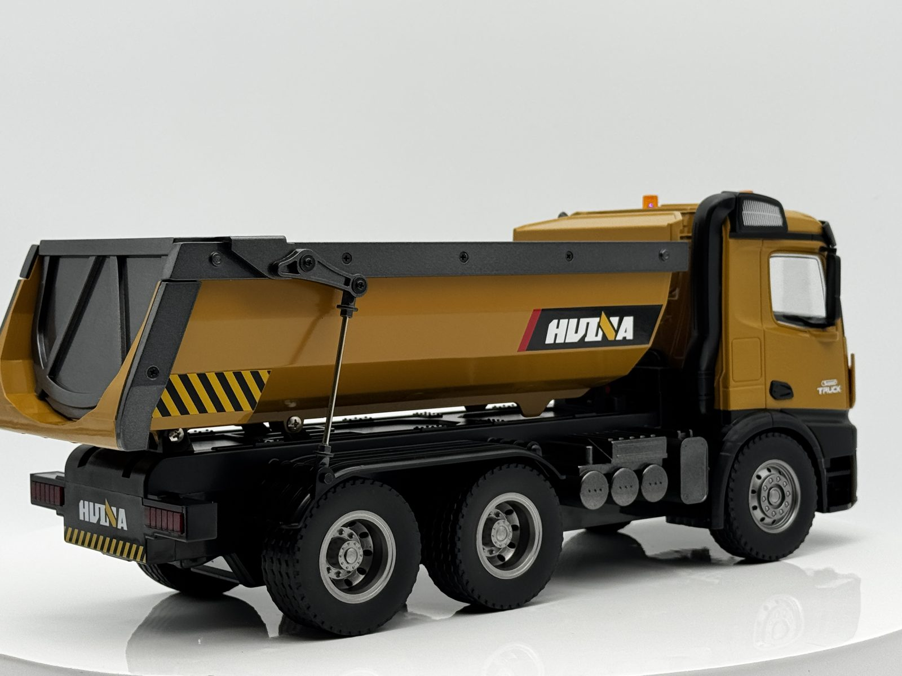
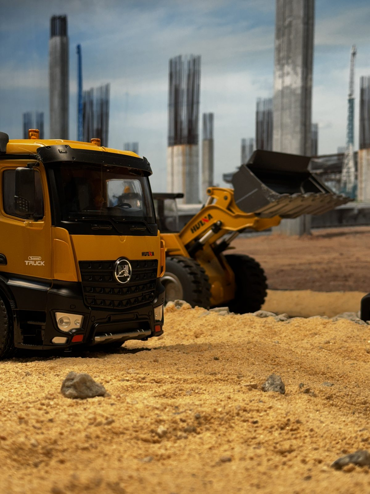

---
tags:
  - Character
  - Military
  - Project H
---

# Björn Stormweld

Confirmed canon

| | |
|---|---|
| Full name | Björn Stormweld |
| Affiliation | Military |
| Rig | Huina 573HD heavy-duty dump truck |
| Program | Project H candidate |

**Björn Stormweld** is a military operator and a candidate in [Project H](../phenomena/project-h.md). He drives a heavy-duty dump truck.

!!! note "Not to be confused with Wolfslayer"
    Björn does **not** carry the callsign "Wolfslayer." That name belongs only to [Wolfslayer](wolfslayer.md), the grey Scania 770S.

## Gallery

{ loading=lazy width="480" }
{ loading=lazy width="360" }

## Get the rig

<!-- AFFILIATE: add the Amazon link here as https://www.amazon.com/dp/ASIN?tag=frederickgeor-20 -->
Rigs from the series ship through [RC Story Direct](https://www.ebay.com/str/rcstorydirect). See also our [curated recommendations](https://a.co/d/01nlJDto).
