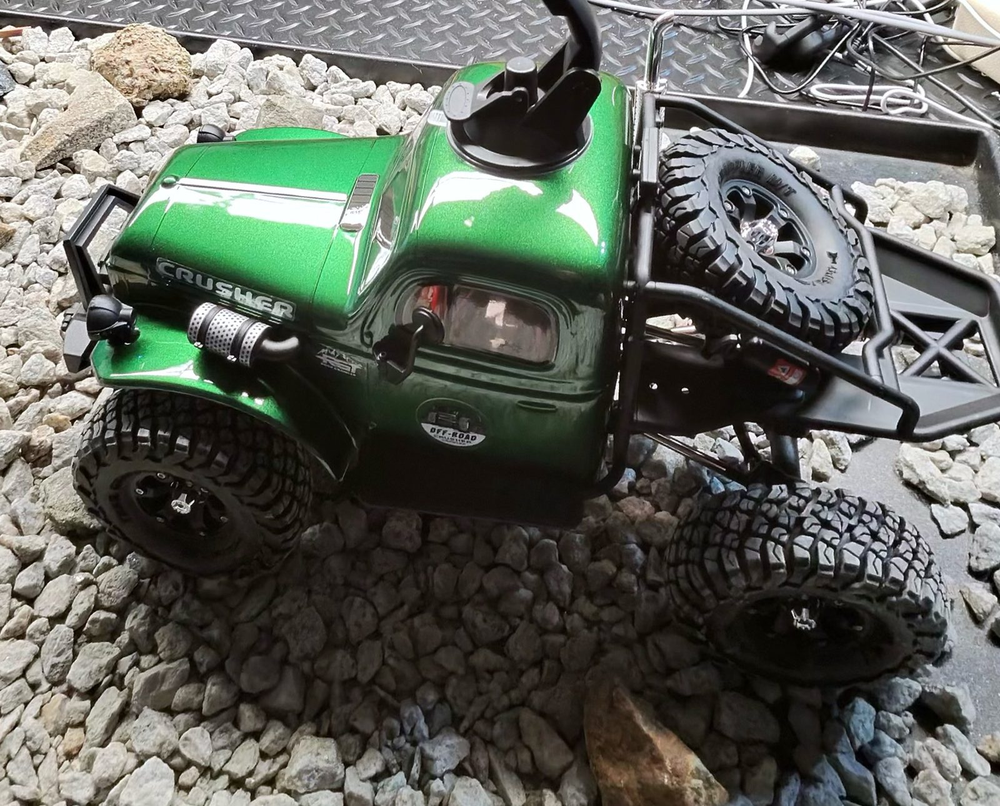

---
tags:
  - Character
  - Civilian
  - Rocky Recon
---

# Hulk

Dossier in progress

| | |
|---|---|
| Nickname | The Green Crusher |
| Rank | Master Sergeant |
| Role | Long-range terrain scout |
| Unit | Crushers 3rd Rift Recon Team |
| Affiliation | Civilian |
| Rig | RGT EX86181 Crusher (Rock Racer) |
| Brother | [Ole Red](ole-red.md) |

**Hulk**, "the Green Crusher," is a Master Sergeant and long-range terrain scout, and a founding member of the Rocky Recon squad, the Crushers 3rd Rift Recon Team. He is [Ole Red](ole-red.md)'s younger brother.

He is the quiet sentinel who spots trouble long before it reaches the squad, scouting choke points and rocky passes on the outer fringes while the construction crew works.

## Origin

Hulk grew up in Ole Red's shadow, learning the grit he'd need to survive, but he forged his own path toward the outer ridgelines early and came to specialize in the outer perimeter.

## Personality

Wise, gritty, powerful and temperamental. He's quick to flare when the squad is threatened, and he has deep terrain intuition. When he growls, the squad moves.

## Gallery

{ loading=lazy width="480" }
{ loading=lazy width="360" }

## Get the rig

<!-- AFFILIATE: add the Amazon link here as https://www.amazon.com/dp/ASIN?tag=frederickgeor-20 -->
Rigs from the series ship through [RC Story Direct](https://www.ebay.com/str/rcstorydirect). See also our [curated recommendations](https://a.co/d/01nlJDto).
