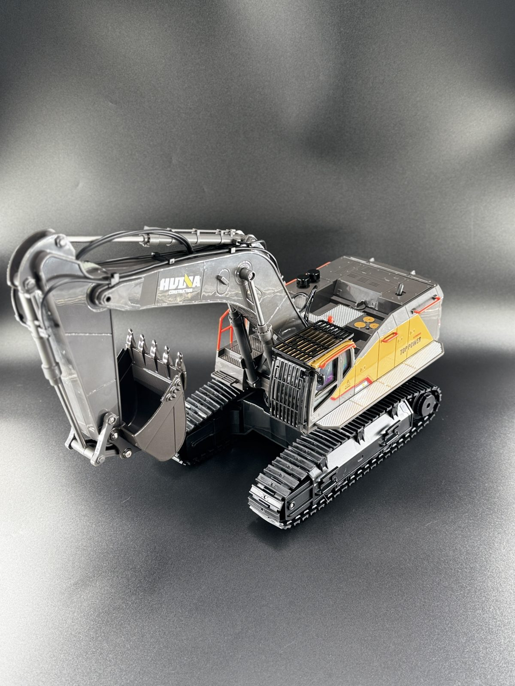
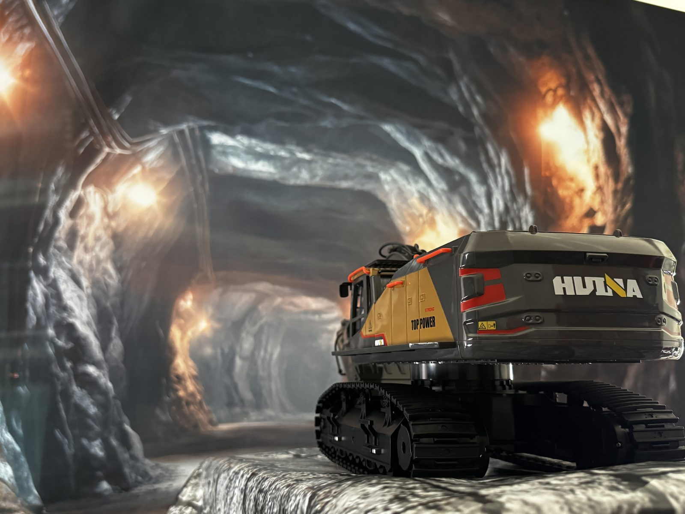

---
tags:
  - Character
  - Military
  - Project H
---

# Huxley

Dossier in progress

| | |
|---|---|
| ID | EX1592 |
| Callsign | ROOKIE (not yet earned) |
| Affiliation | Military |
| Program | Project H evaluation |
| Rig | Huina 1592 excavator |

**Huxley** (ID **EX1592**) is a rookie excavator under evaluation in [Project H](../phenomena/project-h.md). He finished first in his graduating class in every category, and his callsign, **"ROOKIE,"** is one he has not earned yet.

## Profile

He wears a "TOP POWER" insignia. His DNA comes from an ultra-classified gene pool, so his excellence is described simply as "his nature." He holds the highest level of secret clearance that exists. Before his admission into the [17th Interspatial Engineering Group](../units/17th-ieg.md) was approved, investigators went back and interviewed every clone-mate he was cloned alongside, hunting for any behavioral or psychological flaw that might disqualify him. They found none.

## Personality

Beneath the calm, high-achieving exterior, Huxley is uncertain. He replays his own selection process over and over (the interviews, the psychometric resonance scans, the probes) and still can't tell what the evaluators saw in him that he hasn't found in himself. His fear isn't failure. It's the sense that something is expected of him that he hasn't figured out yet.

## In the story

- **Arrival at TitanForge.** Huxley's first arrival comes through [The SPA](../locations/the-spa.md) tunnel into [TitanForge](../locations/titanforge.md). He feels the weight of the ancient carved corridor and the faint hum of machinery older than his own generation, and he senses that the facility isn't just a facility. It's a threshold he is being tested against.
- **Proving grounds.** He does early earthwork at the proving grounds alongside [K-Tool](k-tool.md). In the [Mulch-Bed Evaluation](../phenomena/mulch-bed-evaluation.md) ("the Sorting," Episode 0.5) he's judged as a probe-grade precision unit.
- **Convoy.** In the Episode 01 loading manifest he rides a B-36 hauler with the Yigong bulldozer, and he later appears on the Shadowrift Barricade convoy manifest as the "1592 Excavator — precision digger."

## Connections

- [K-Tool](k-tool.md), fellow rookie at the proving grounds
- [Mûmak](mumak.md), the prime mover that hauls the rookies
- [Oliphaunt](oliphaunt.md), fellow evaluation candidate
- The [Iron Scorpions](../units/iron-scorpions.md), K-Tool's crew in the 17th IEG

## Gallery

{ loading=lazy width="360" }
{ loading=lazy width="480" }

## Get the rig

<!-- AFFILIATE: add the Amazon link here as https://www.amazon.com/dp/ASIN?tag=frederickgeor-20 -->
Rigs from the series ship through [RC Story Direct](https://www.ebay.com/str/rcstorydirect). See also our [curated recommendations](https://a.co/d/01nlJDto).
