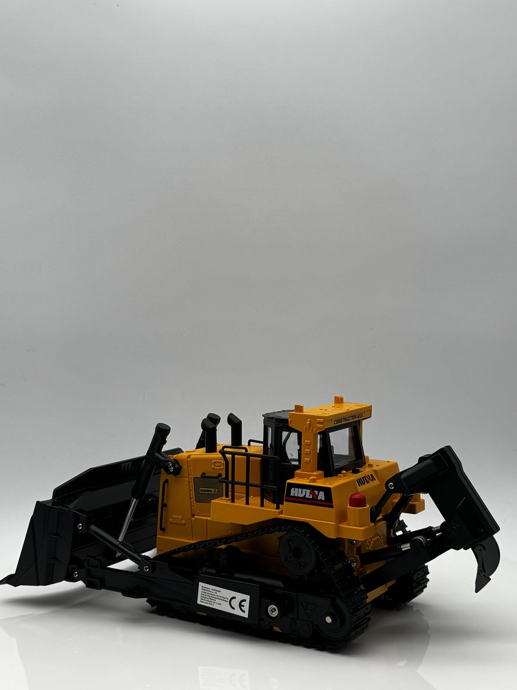
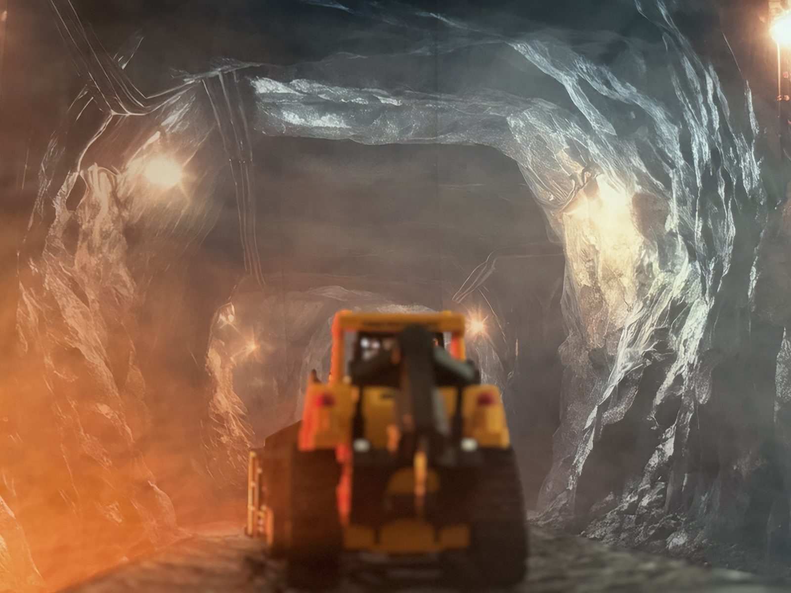

---
tags:
  - Character
  - Military
  - Project H
---

# K-Tool

Confirmed canon

| | |
|---|---|
| Affiliation | Military |
| Rig | Huina 1554 bulldozer |
| Program | Project H candidate |

**K-Tool** is a military bulldozer operator and a candidate in [Project H](../phenomena/project-h.md).

## Gallery

{ loading=lazy width="360" }
{ loading=lazy width="480" }

## Get the rig

<!-- AFFILIATE: add the Amazon link here as https://www.amazon.com/dp/ASIN?tag=frederickgeor-20 -->
Rigs from the series ship through [RC Story Direct](https://www.ebay.com/str/rcstorydirect). See also our [curated recommendations](https://a.co/d/01nlJDto).
