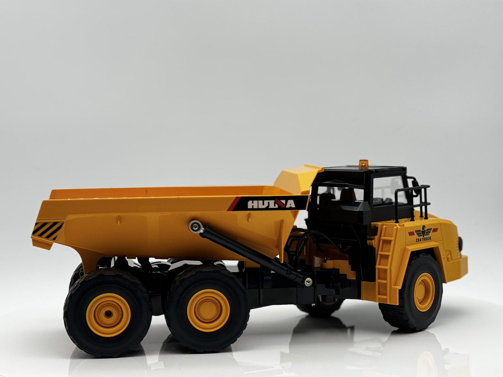
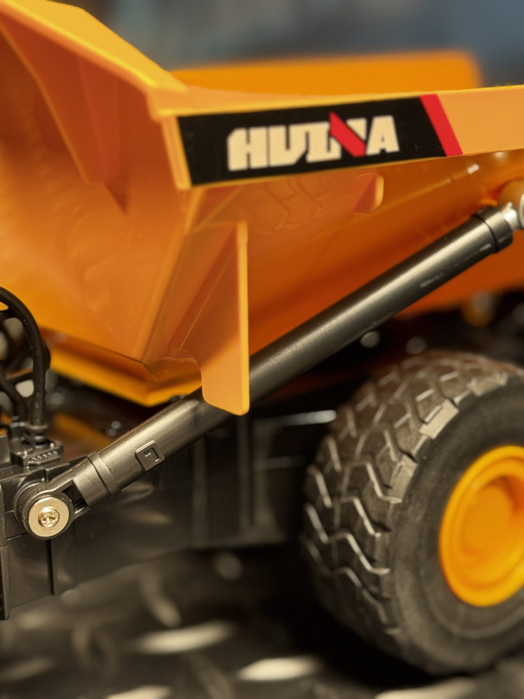

---
tags:
  - Character
  - Civilian
  - Project H
---

# Oliphaunt

Dossier in progress

| | |
|---|---|
| Pronunciation | OH-lih-font |
| Role | Rookie heavy, evaluation candidate |
| Affiliation | Civilian |
| Rig | Volvo A40G articulated dump truck |

**Oliphaunt** ("OH-lih-font") is the largest rookie in the [Mulch-Bed Evaluation](../phenomena/mulch-bed-evaluation.md) and the heaviest payload [Mûmak](mumak.md) carries. He is colossal, golden and untested, and he has no idea of the [**Dragonstone**](../phenomena/dragonstone.md) destiny said to be buried beneath the rocks he'll one day help move.

In the Episode 01 loading manifest he appears as the "Volvo Arty Dumptruck" on B-36-1.

## Connections

- [Mûmak](mumak.md), his hauler
- [Huxley](huxley.md), fellow evaluation candidate

## Gallery

{ loading=lazy width="480" }
{ loading=lazy width="360" }

## Get the rig

<!-- AFFILIATE: add the Amazon link here as https://www.amazon.com/dp/ASIN?tag=frederickgeor-20 -->
Rigs from the series ship through [RC Story Direct](https://www.ebay.com/str/rcstorydirect). See also our [curated recommendations](https://a.co/d/01nlJDto).
