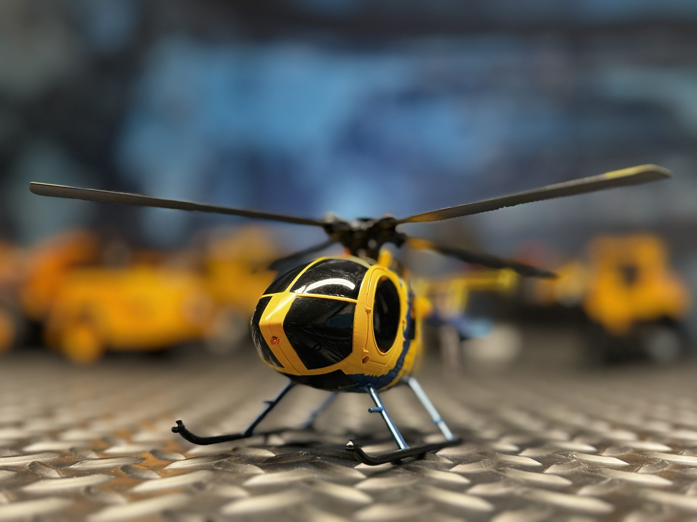
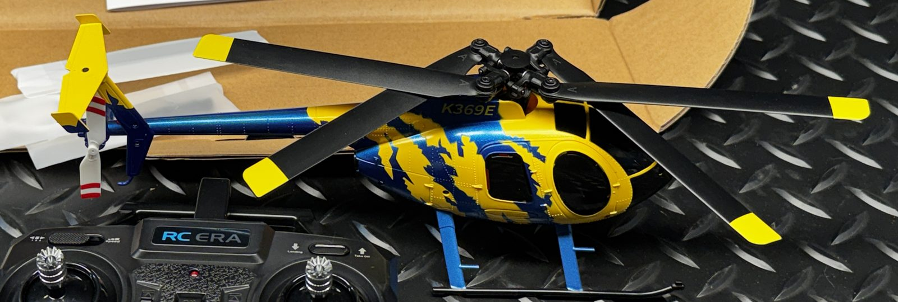

---
tags:
  - Character
  - Military
  - Aviation
---

# Valkyrie

Dossier in progress

| | |
|---|---|
| Role | Pilot and squad leader |
| Unit | Valkyrie Detachment |
| Affiliation | Military |
| Rig | C184 MD500 micro heli (about 1:32 scale) |

**Valkyrie** is the pilot and squad leader of the Valkyrie Detachment, flying aerial overwatch and coordination for ground stabilization and extraction. She is renowned for her calm under pressure and has an almost mythic, guardian-angel presence over the crews below, including [Aurek](aurek.md)'s.

## The rig

A C184 MD500 micro heli kit: a 239 mm body and a 256 mm rotor. Measured against a full-size MD 500, that's roughly 1:32 scale.

## Gallery

{ loading=lazy width="480" }
{ loading=lazy width="480" }

## Get the rig

<!-- AFFILIATE: add the Amazon link here as https://www.amazon.com/dp/ASIN?tag=frederickgeor-20 -->
Rigs from the series ship through [RC Story Direct](https://www.ebay.com/str/rcstorydirect). See also our [curated recommendations](https://a.co/d/01nlJDto).
