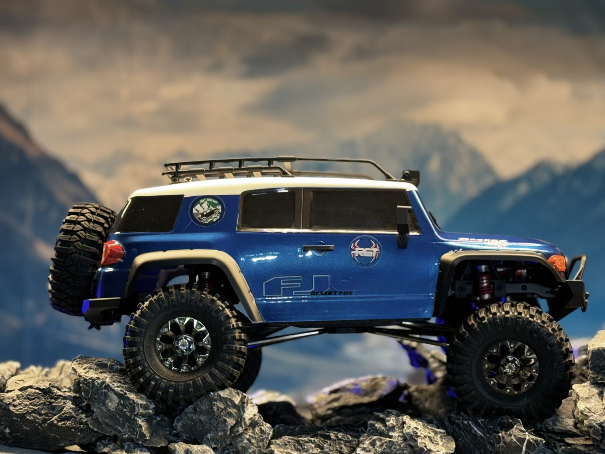
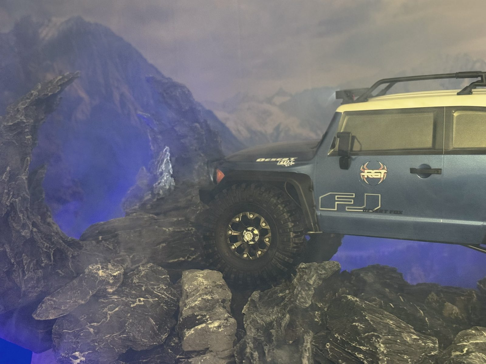
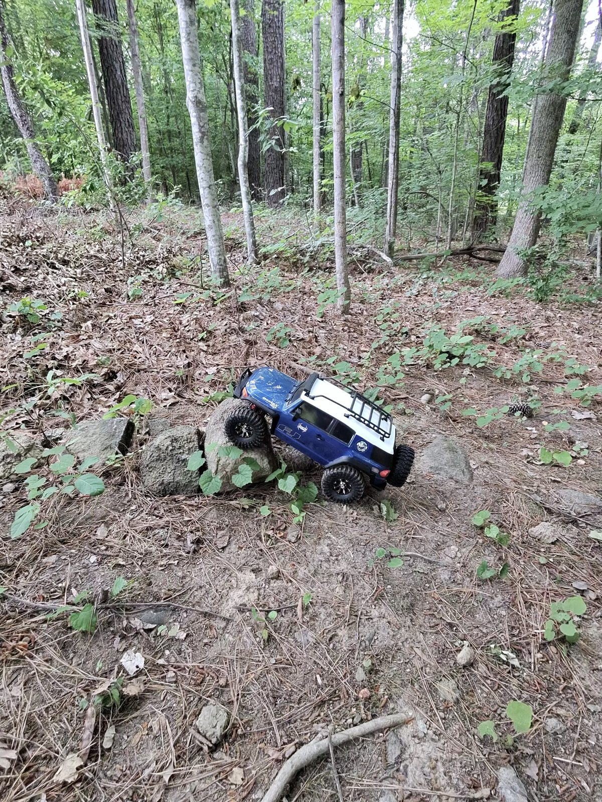

---
tags:
  - Character
  - Joint
  - RRGC
---

# Vantor & Solance

Dossier in progress

| | |
|---|---|
| Unit | RRGC (Rapid Response Global Cavalry) |
| Affiliation | Joint |
| Vantor's rig | Blue RGT EX86120 Desert Fox (FJ Cruiser-style body) |
| Solance's rig | Yellow RGT EX86120 Desert Fox |
| Doctrine | Twin Spear Doctrine |

**Vantor** and **Solance** serve with the [RRGC](../units/rrgc.md), the Rapid Response Global Cavalry. Together they form the **Twin Spear Doctrine**: Vantor breaks trail and secures the route, and Solance follows with stabilization and extraction. They're called the fastest deployable crawler pair on the planet.

## Vantor

*Blue Desert Fox, forward scout and terrain interceptor.*

Vantor is the Cavalry's first-in specialist: fast, sharp and built for rapid deployment onto hazardous ground. He was tested on a coastal desert proving range of salt, sand and heat that destroyed lesser prototypes. He learned airflow, sandflow and traction where other machines sank, and his logs flagged him **"RR-1: Rapid Response Potential,"** which earned him a slot as the Cavalry's first scout-class crawler.

His specialties are dune traversal, hazard scouting, route securing and debris-field navigation. He also flies recon overwatch as FJ Blue in the [Rocky Recon Interspatial Squad](../units/rocky-recon-interspatial-squad.md).

He is hyper-aware and reads terrain like a language. He has a dry sense of humor under pressure, protects slower and heavier units, and is fast but never reckless.

## Solance

*Yellow Desert Fox, heavy support and rescue anchor. GS-10.*

Solance ("SOH-lance," from *Sol* and *Lance*) is the Cavalry's stabilizer, built for rescue, extraction and load control, and he uses his weight and torque like a shield. He carries the tools, tow gear and emergency kits. He was forged in mountain rescue training yards of shale, ice and steep inclines, where he excelled at control under pressure rather than raw speed. His instructors nicknamed him **"The Sun That Doesn't Set."**

He is warm, steady and team-first, and unshakably brave. He will charge into danger to pull someone out, and he never leaves anyone behind.

## Connections

- [Sleipnir](sleipnir.md), also of the Cavalry
- [Base Director](base-director.md), who drives the same blue Desert Fox as Vantor

## Gallery

{ loading=lazy width="480" }
{ loading=lazy width="480" }
{ loading=lazy width="480" }

## Get the rig

<!-- AFFILIATE: add the Amazon link here as https://www.amazon.com/dp/ASIN?tag=frederickgeor-20 -->
Rigs from the series ship through [RC Story Direct](https://www.ebay.com/str/rcstorydirect). See also our [curated recommendations](https://a.co/d/01nlJDto).
