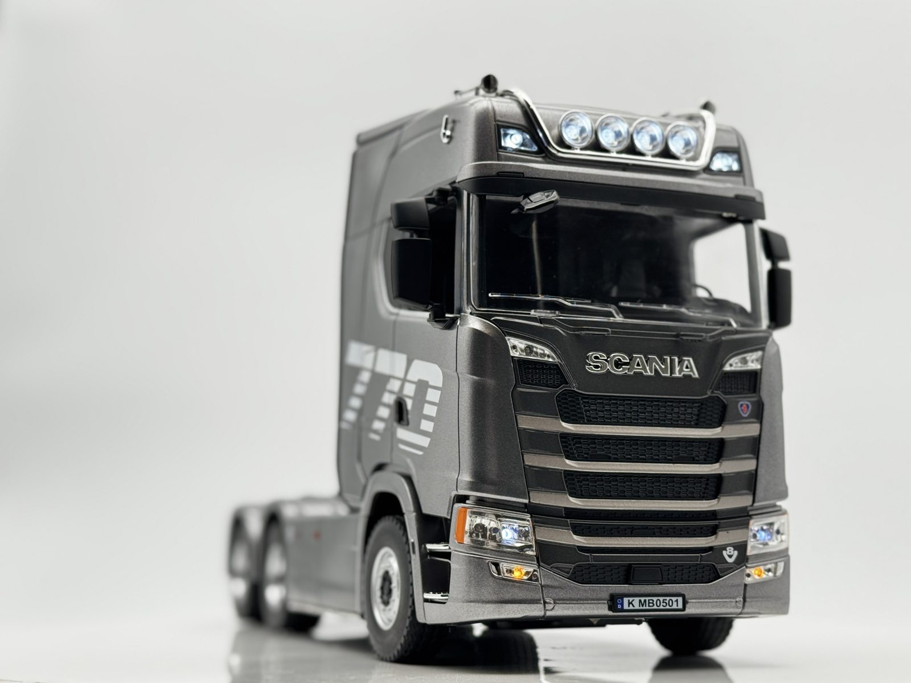
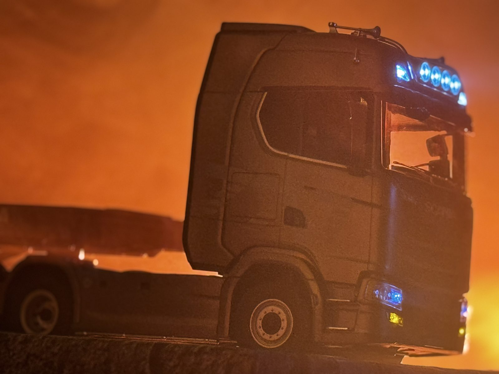

---
tags:
  - Character
  - Unknown affiliation
  - Convoy
---

# Wolfslayer

Confirmed canon

| | |
|---|---|
| Role | Convoy lead, heavy tactical hauler |
| Affiliation | Unknown |
| Rig | Grey Scania 770S heavy hauler (Huina 1501/1502) |

**Wolfslayer** is a grey Scania 770S heavy hauler, and the one true Wolfslayer. Its allegiance is unknown.

He was forged in the extreme outer slices, and he runs first in, last out. He is the convoy's lead heavy hauler. He isn't a commander. He is the "alpha truck" that sets the pace and carries the heaviest, most dangerous or most sensitive loads, including [Ripsaw](ripsaw.md) and Small Arty. [Brady](brady.md) calls him "the ghost truck," because he seems to appear out of nowhere.

## Personality

Stoic, cold and unshakably reliable. He speaks only when absolutely necessary. The rookies find him unsettling precisely because he never reacts. He just moves.

## On the road

Wolfslayer has hauled Unit 1583 ([Aurek](aurek.md)) up a steep driveway grade, slipping briefly over a crack before recovering. Keeping the loader's weight centered over the trailer axles made the climb.

## The name

The grey Scania needed a name colder and more tactical than the rest of the convoy. Ironjaw and Ghostrunner were considered, and Wolfslayer won for the grey colour, the heavy-haul role and the silent alpha-truck personality.

## Connections

- [Halden Cross](halden-cross.md), who coordinates the convoy
- [Mûmak](mumak.md), his off-road counterpart
- [Pug](pug.md), a separate Scania in the Empress Transport Brigade

## Gallery

{ loading=lazy width="480" }
{ loading=lazy width="480" }

## Get the rig

<!-- AFFILIATE: add the Amazon link here as https://www.amazon.com/dp/ASIN?tag=frederickgeor-20 -->
Rigs from the series ship through [RC Story Direct](https://www.ebay.com/str/rcstorydirect). See also our [curated recommendations](https://a.co/d/01nlJDto).
